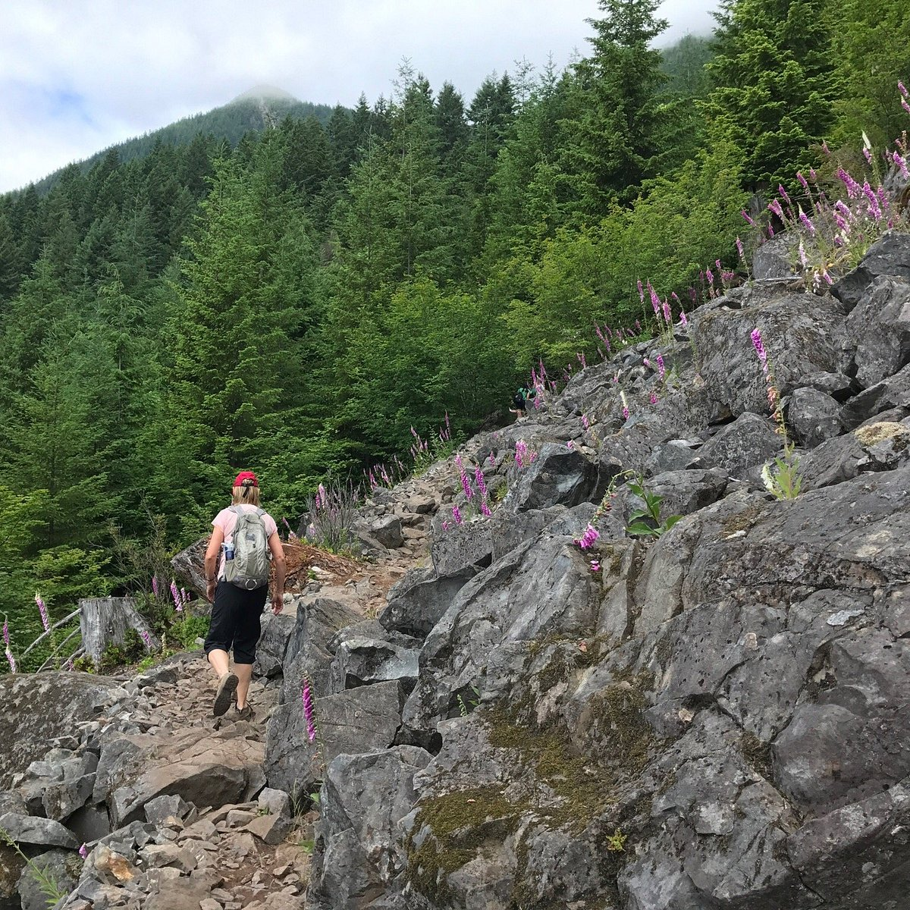

# About Me

Hello! My name is Muhammad Zaidi. I study at the University of Washington. This page says a little about me.

## Academics

I am majoring in Computer Science and minoring in Technical & Professional Communication. I am currently enrolled in **ENGL396: Software Documentation**. When I graduate, 
I plan to become a software engineer or a AI engineer.

Here is a list of my favorite classes at UW:

- [Intro to Computer Science III](https://myplan.uw.edu/course/#/courses/CSE%20123?id=3f2804ee-24e3-48bb-aa87-6b12cc919a87)
- [Perspectives on Film: Genre](https://myplan.uw.edu/course/#/courses/CMS%20272?id=409bc708-8fb0-4d9e-ba81-e052a2cfe98f)
- [Introduction to Data Management](https://myplan.uw.edu/course/#/courses/CSE%20344?id=6b47e349-1476-4fa5-b05a-3d89b30ece51)

## Hiking Background

One of my favorite pastimes is hiking. Here are some of the hikes I've done and how I would rank them:

| Hike | Difficulty |
|---------:|------------|
| Tiger Mountain   | Medium    |
|  Teneriffe Falls    | Hard    |
|  Rattlesnake lake     | Hard       |

## Words of Wisdom

One of my favorite quotes is from Imam Ali:

> "Two things define you: your patience when you have nothing and your attitude when you have everything."
